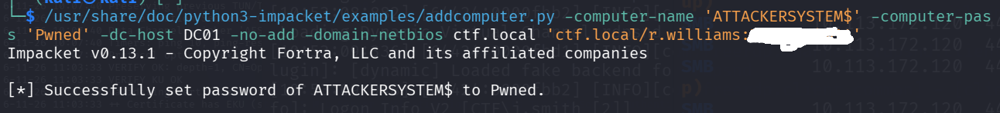
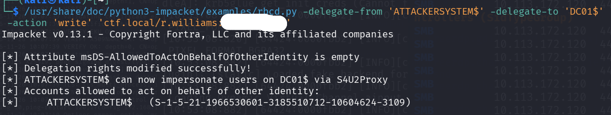

# Forward - Technical Deep Dive

### Purpose

This writeup focuses on explaining why the techniques used in Forward challenge in TryHackMe worked and how the underlying systems operate. The  goal is to understand what the technology does, how it works, why it matters to security and how it connects the challenge not merely to describe commands.

### **Technical Deep Dive — Topics Covered**

**1. KeePass and Credential Storage**

* Understanding KeePass and password database files (`.kdbx`).
* Analysing `database.kdbx` and extracting stored credentials.
* Understanding how credential reuse can enable lateral movement.

**2. AddAllowedToAct**

* Understanding the `AddAllowedToAct` permission.
* How this permission can be abused to configure RBCD.

**3. Resource-Based Constrained Delegation (RBCD)**

* Understanding Kerberos delegation.
* How RBCD works and how it differs from traditional constrained delegation.
* The role of the `msDS-AllowedToActOnBehalfOfOtherIdentity` attribute.
* Where the security weakness exists

**4. Machine Account Creation and Kerberos Exploitation**

* Understanding Active Directory machine accounts.
* Creating the `ATTACKERSYSTEM$` machine account.
* Why a controlled machine account is useful in an RBCD attack.
* Requesting a service ticket through Kerberos delegation.
* Using the resulting ticket to obtain elevated access.

### **1. KeePass and Credential Storage**

#### **What is it ?**&#x20;

KeePass is a free, open-source password manager that stores login credentials, notes, and other sensitive information in an encrypted database file, typically using the `.kdbx` format. Access to the database is protected by a composite master key, which can consist of a master password, a key file, a Windows user account key, or a combination of these components.

KeePass has two main versions: KeePass 1.x and KeePass 2.x. They differ in supported features and key-protection options. For example, KeePass 2.x supports Windows user account integration and Argon2 key derivation, while KeePass 1.x does not. KeePass 2.x also supports additional features through its plugin architecture.

<figure><figcaption></figcaption></figure>

#### **How it works internally and why it exists**

The password list is saved by default as a.kdbx file but it can be exported to .txt, HTML, XML and CSV. It also supports simultaneous access and simultaneous changes to a shared password file by multiple computers (often by using a shared network drive).

KeePass has a global auto-type hotkey, which when a user presses down looks up the selected or correct entry and enters every login and/or password characters sequence.

KeePass may be configured to randomize characters input sequence to make it harder to log keystrokes. The feature is called Two Channel Auto-Type Obfuscation (TCATO).

KeePass automatically clears the clipboard sometime after the user has copied one of the passwords into it. It has features that protect against clipboard monitors.

KeePass encrypts its database using symmetric encryption. KeePass 1.x supports AES and Twofish, while KeePass 2.x supports AES and ChaCha20 by default. Additional encryption algorithms can be made available through plugins. The encryption algorithm is separate from the key derivation function, which transforms the composite master key into the encryption key. KeePass supports AES-KDF, while KeePass 2.x also supports Argon2.

#### **Where the security weakness lies and how it was used in the challenge**

KeePass is not inherently vulnerable but the security issue in this was that an accessible .kdbx database (Database.kdbx)contains stored credentials that could be recovered and subsequently used to gain access to other accounts.

We learnt that KeePass 2.x supports using the current Windows user account as one of the components of a database's composite master key. This means that access can depend on the original Windows user account. However, opening the database by simply clicking OK does not, by itself, prove that this feature was enabled. KeePass can also remember the location of a key file and load it automatically. Therefore, without verifying the database's key configuration, we cannot conclusively determine why the database opened without manually entering a password.

### **2.AddAllowedToAct**

`AddAllowedToAct` is a BloodHound edge that represents a security principal's ability to modify the Resource-Based Constrained Delegation (RBCD) configuration of another object. More specifically, it indicates that the principal has sufficient permissions to modify the target object's `msDS-AllowedToActOnBehalfOfOtherIdentity` attribute.

#### **Why does it exist ?**&#x20;

Active Directory uses Access Control Lists (ACLs) to determine which security principals can perform specific actions on directory objects. A Discretionary Access Control List (DACL) contains Access Control Entries (ACEs), which specify the security principal, the permissions granted or denied, and the object or attribute to which those permissions apply.

| Right                            | Meaning                                       |
| -------------------------------- | --------------------------------------------- |
| `GenericAll`                     | Full control                                  |
| `GenericWrite` / `WriteProperty` | Modify attributes (all or specific ones)      |
| `WriteDacl`                      | Change the permissions                        |
| `WriteOwner`                     | Take ownership                                |
| `ExtendedRight`                  | Special actions, such as resetting a password |

#### Where the security weakness lies

AddAllowedToAct is not itself an attack or a vulnerability. it is a permission relationship. the security weakness is the inappropriate assignment of that permission which can enable RBCD abuse.&#x20;

In our case r.williams had this level of control and was granted the permission to modify the domain controller's (DC01.ctf.local) delegation configuration.&#x20;

#### How it can be detected and prevented

To mitigate the abuse of the `AddAllowedToAct` permission, organizations should enforce the principle of least privilege by restricting who can modify resource-based constrained delegation settings on Active Directory objects. Regular ACL audits should be conducted to identify and remove excessive permissions, while monitoring changes to the `msDS-AllowedToActOnBehalfOfOtherIdentity` attribute can help detect unauthorized delegation configurations.&#x20;

To add on, organizations should review machine-account creation policies and restrict unnecessary machine-account creation to reduce opportunities for attackers to establish accounts for delegation abuse.

### **3. Resource-Based Constrained Delegation (RBCD)**

#### **What is Kerberos delegation?**

Kerberos delegation is a mechanism in Active Directory that allows a service to access another service on behalf of an authenticated user.

We also have delegation attributes, which lets a service act on behalf of another user to another service. We have the following 3 types:

| Type                  | Attribute / flag                                                                           | Who can configure it                                     |
| --------------------- | ------------------------------------------------------------------------------------------ | -------------------------------------------------------- |
| Unconstrained         | `TRUSTED_FOR_DELEGATION` in `userAccountControl`                                           | Needs write access **and** `SeEnableDelegationPrivilege` |
| Constrained           | `msDS-AllowedToDelegateTo` (plus `TRUSTED_TO_AUTH_FOR_DELEGATION` for protocol transition) | Same as above                                            |
| Resource-based (RBCD) | `msDS-AllowedToActOnBehalfOfOtherIdentity` on the **target**                               | Write access to that attribute is enough                 |

#### How RBCD Works and Traditional Constrained Delegation

Traditional Constrained Delegation is configured on the front-end service and uses an outbound allow-list ("who i can talk to") while RBCD flips that model by configuring the permission directly on the back-end resource which uses an inbound allow-list("who is allowed to talk to me").

**For example in our case, imagine:**

* `DC01$` — the target computer.
* `ATTACKERSYSTEM$` — an attacker-controlled machine account.
* `Administrator` — the user whose identity the attacker wants to impersonate.

The target computer can be configured to allow ATTACKERSYSTEM$ to delegate authentication on behalf of Administrator to its services.&#x20;

This is the fundamental mechanism behind RBCD abuse.

The important distinction is the direction of control.

* Traditional constrained delegation: The delegating service specifies where it can delegate. The AD attribute: msDS-AllowedToDelegateTo
* RBCD: The target resource specifies who can delegate to it. The AD attribute: msDS-AllowedToActOnBehalfOfOtherIdentity

<figure><figcaption></figcaption></figure>

#### Understanding `msDS-AllowedToActOnBehalfOfOtherIdentity`

This attribute contains a security descriptor that identifies which security principals are permitted to act on behalf of other users when accessing the resource through Kerberos delegation.&#x20;

**In Forward:**

* `DC01$` is the target.
* `ATTACKERSYSTEM$` is the account intended to receive delegation permission.
* The RBCD configuration establishes the trust between them.

This is where the earlier `AddAllowedToAct`  becomes important.

It allows the compromised account to modify the target's delegation configuration, potentially adding an attacker-controlled account to the list of trusted delegators.

#### Where is the security weakness?

RBCD becomes a security concern when an attacker obtains sufficient permissions to modify a target computer's delegation configuration.

The consequences can include:

* **Identity impersonation:** An attacker can request Kerberos service tickets representing another user.
* **Privilege escalation:** If the impersonated user has administrative privileges on the target, the attacker may gain administrative access.
* **Lateral movement:** The attacker can use the resulting service ticket to authenticate to services on another computer.
* **Unauthorized delegation:** An attacker can establish a delegation relationship that the organization did not intend.

### **4. Machine Account Creation and Kerberos Exploitation**

#### What is a machine account?&#x20;

In AD, computers have their own accounts, just like users. This account allows the computer to authenticate to the domain, communicate with the DC and access network resources.&#x20;

One important distinction is that computer accounts conventionally end with $.&#x20;

A computer account is essentially a security principal. This means that it has an identity, permissions, and credentials that can be used during authentication.&#x20;

#### Why it matters in Forward

Our attack required an account that we controlled and could use as the delegating principle in an RBCD configuration. This is where ATTACKERSYSTEM$ comes in.

Rather than using an existing computer account that we might not control we created a new machine account that we could manage.

**In Forward, the relationship we wanted was:**

<figure><figcaption></figcaption></figure>

We therefore used Impacket;s addcomputer.py for this;

<figure><figcaption></figcaption></figure>

The reason why this is useful is that the target computer's RBCD configuration tells the Key Distribution Centre (KDC)that this principle is authorised to delegate on behalf of other users to its services. Now this creates the opportunity to request a service ticket representing a more privileged user.

<figure><figcaption>
We just configured the target computer(DC01$) to trust our machine account(ATTACKERSYSTEM$) for resource based constrained delegation.
</figcaption></figure>

#### Requesting a service ticket through Kerberos Delegation

To understand this we need two Kerberos extensions:

**S4U2Self - Service for User to Self**

Allows a service to request a Kerberos service ticket to itself on behalf of another user.&#x20;

For example, our controlled service principal can request a ticket representing `Administrator`.

**S4U2Proxy - Service for User to Proxy**

Allows a service to use an evidence ticket obtained through S4U2Self to request a service ticket to another service on behalf of that user.

In our case, the objective was to obtain a ticket for the CIFS service on DC$.

**How this works in Forward**

ATTACKERSYSTEM$\
|\
v\
S4U2Self\
|\
v\
Request a ticket representing Administrator\
|\
v\
Obtain an evidence ticket\
|\
v\
S4U2Proxy\
|\
v\
Request a ticket for CIFS/DC01\
|\
v\
Administrator service ticket

#### What did we obtain

We obtained a Kerberos service ticket representing Administrator for:

`CIFS/DC01`  Service Principal Name(SPN).

CIFS is the service associated with file-sharing access over SMB.

This is important because the ticket is not a universal Administrator login. It is a service-specific ticket that can be used to authenticate to the corresponding service, subject to the target's authorization checks.

<figure><figcaption></figcaption></figure>

#### Using the resulting Ticket to obtain Elevated Access

Now we have an Administrator service ticket for `CIFS/DC01`.

Why is this useful?

CIFS is associated with SMB, which allows access to network shares and supports certain forms of remote administration.

Tools such as Impacket's PsExec can use SMB authentication to execute commands remotely when the authenticated identity has sufficient privileges.

**In Forward, the final progression was:**

Administrator CIFS Service Ticket\
|\
v\
Kerberos Authentication\
|\
v\
SMB / CIFS\
|\
v\
PsExec\
|\
v\
SYSTEM-Level Shell

One important distinction: the Kerberos ticket provided the authentication capability. PsExec provided the remote execution mechanism. The resulting SYSTEM shell depended on the privileges available to the impersonated Administrator identity.

### Putting the entire attack together&#x20;

This is the complete relationship between the concepts we've studied:

<figure><figcaption></figcaption></figure>

